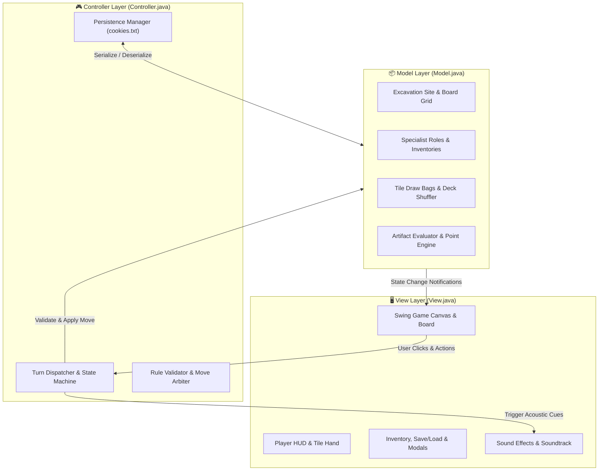

# 🏆 Capstone Term Project: "Amphipolis" Board Game
> **Course:** [HY-252: Object-Oriented Programming](https://elearn.uoc.gr/course/view.php?id=5974) — University of Crete (UoC CSD)  
> **Author / Student:** Rafail Ioannis Petrakis (`csd5748`)  
> **Architecture:** Model-View-Controller (MVC Pattern)  
> **Deliverables:** [`ReportA.pdf`](./ReportA.pdf) (Phase A Design) & [`ReportB.pdf`](./ReportB.pdf) (Phase B Implementation)  
> **Documentation:** Complete Javadoc in [`javadoc/`](./javadoc/index.html) & UMLs in [`UMLs/`](./UMLs/)

---

## 📑 Overview

**"Amphipolis"** is a full-featured, interactive desktop strategy board game recreating the archaeological excavation of the famous **Kasta Tomb in ancient Amphipolis**. Players lead teams of archaeological specialists competing to discover ancient Greek artifacts, assemble multicolored mosaics, reconstruct monumental statues (Sphinxes & Caryatids), piece together historical skeletons, and categorize rare amphoras before subterranean landslides seal the tomb forever.

The game is built upon a strict **Model-View-Controller (MVC)** software architecture, featuring a custom Java Swing graphical user interface, animated tile placement, spatial audio tracks, persistent game state save/load mechanics (`cookies.txt`), and a comprehensive automated JUnit 4 test suite.

---

## 🗂️ Project Directory Map

```text
Project/
├── javadoc/                      # Complete Javadoc API Documentation (Interactive HTML)
├── UMLs/                         # High-Resolution UML Diagrams (Phase A & Phase B)
│   ├── [1] MVC.png              # Phase A Class Diagram & Design Contracts
│   ├── [1] Model.png            # Phase A Model Hierarchy
│   ├── [1] View.png             # Phase A View Interface Scaffolding
│   ├── [1] Controller.png       # Phase A Event Listener Protocol
│   ├── [2] Main.png             # Phase B Main Launch Hierarchy
│   ├── [2] Model.png            # Phase B Complete Entity Engine
│   ├── [2] View.png             # Phase B Swing GUI Component Graph
│   └── [2] Controller.png       # Phase B Action Dispatcher & Flow Engine
├── src/
│   ├── assets/                  # High-Resolution Visual & Acoustic Game Assets
│   │   ├── img/                 # Board maps, artifact tiles, cards & character portraits
│   │   └── msc/                 # Ambient background soundtrack & voice tracks (.wav)
│   ├── PhaseA/                  # Phase A Architectural Design Contracts & Stubs
│   │   └── MVC/                 # Abstract Model, View, and Controller definitions
│   └── PhaseB/                  # Phase B Full Production Implementation
│       ├── Main.java            # Desktop Game Entry Point
│       ├── MVC/                 # Production Engine:
│       │   ├── Model.java       # Game state, players, bags, tiles & scoring logic
│       │   ├── View.java        # Interactive Swing GUI, board canvas, inventory dialogs
│       │   └── Controller.java  # Turn coordinator, input validation & event dispatching
│       └── JUnitTests/          # Automated Verification Suite:
│           └── GameTests.java   # Unit tests for scoring, bag drawing, turns & win conditions
├── Amphipolis.jar               # Pre-compiled Standalone Executable Game
├── cookies.txt                  # Game State Persistence File (Save & Resume System)
├── Instructions.pdf             # Official Course Project Specification
├── ReportA.pdf                  # Phase A Architecture & Engineering Report
├── ReportB.pdf                  # Phase B Final Implementation Report
├── Project.iml                  # IntelliJ Module Definition
└── README.md                    # Dedicated Project Documentation
```

---

## 🏛️ System Architecture (MVC Pattern)



* **`Model.java`**: Pure business logic. Tracks players, current turns, bag contents (105 finding tiles + 30 landslide tiles), excavation site matrices, player tile holdings, and the dynamic scoring calculator. Contains zero UI code.
* **`View.java`**: Pure presentation. Renders the board map, player character cards, finding bags, animated tile grids, scoring summaries, and dialog windows. Decoupled from game rules.
* **`Controller.java`**: Orchestrates turn flow, translates UI clicks into model actions, validates move legality, enforces action point budgets, manages save/load serialization, and triggers win/loss sequences.

---

## 🏺 Gameplay Rules & Mechanics

### 1. 👥 Archeological Specialists
Each player selects a specialized archaeologist role granting unique tactical advantages:
* **Archaeologist**: Draws extra finding tiles from the excavation bags per turn.
* **Assistant**: Holds higher tile carrying capacity and can reorganize unplaced tiles.
* **Digger**: Quickly clears dangerous Landslide debris from excavation entrances.
* **Professor**: Scores multiplier bonus points when evaluating completed mosaics and complex skeletons.

### 2. 🧩 Artifacts & Scoring Engine
* **Mosaics (27 tiles)**: 4-piece color mosaics (Red, Green, Yellow). Completed 4-piece mosaics yield major victory points; partial mosaics score incrementally.
* **Amphoras (30 tiles)**: 6 vibrant colors (Blue, Brown, Red, Green, Yellow, Purple). Collecting sets of distinct colors multiplies score exponentially.
* **Skeletons (30 tiles)**: Upper/Lower body parts for adult and child remains. Reconstructing matching pairs yields archaeological acclaim.
* **Monumental Statues (24 tiles)**: Reconstructing the majestic **Sphinxes** and **Caryatids** guarding the entrance zones.
* **Landslides (16 tiles)**: Every landslide drawn from the bag blocks an entrance sector. When all 16 landslides are revealed, the tomb collapses and the game concludes immediately!

### 3. 💾 State Persistence System (`cookies.txt`)
The game incorporates full game-state persistence:
* Players can save their game at any moment during a match.
* The complete board matrix, player inventories, remaining tiles in bags, and current turn state are serialized into `cookies.txt` and can be resumed seamlessly across sessions.

---

## 🧪 Automated Testing (JUnit 4)

The test suite in [`src/PhaseB/JUnitTests/GameTests.java`](./src/PhaseB/JUnitTests/GameTests.java) provides comprehensive regression coverage:
* **Tile Bag Integrity**: Validates bag counts, distribution of artifact types, and random shuffling algorithms.
* **Move Validation**: Verifies action point constraints, legal tile placement rules, and turn progression.
* **Scoring Accuracy**: Asserts correct point calculations across complex mosaic combinations, amphora color sets, and skeleton assemblies.
* **Endgame Triggers**: Asserts immediate game termination upon drawing the final landslide tile or exhausting all artifact supplies.

---

## 🚀 How to Launch & Play

### Option 1: Standalone 1-Click Executable JAR (Recommended)
You can launch the game immediately without compiling:

```bash
# Double-click Amphipolis.jar OR run from terminal:
java -jar Amphipolis.jar
```

### Option 2: Compiling & Running from Source

```bash
# Navigate to the project root
cd HY-252/Project

# Compile Phase B source files
javac -d out src/PhaseB/Main.java src/PhaseB/MVC/*.java

# Copy assets to the build output directory
xcopy /E /I src\assets out\assets

# Run the game
java -cp out PhaseB.Main
```

### Option 3: Running JUnit 4 Tests

```bash
# Run test suite via JUnit console runner or IntelliJ Test Runner
javac -cp ".;lib/junit-4.13.2.jar;lib/hamcrest-core-1.3.jar;src" -d out src/PhaseB/JUnitTests/GameTests.java
java -cp ".;lib/junit-4.13.2.jar;lib/hamcrest-core-1.3.jar;out" org.junit.runner.JUnitCore PhaseB.JUnitTests.GameTests
```

---

## ⚖️ Academic Integrity & Disclaimer

* **Academic Purpose:** Developed as the capstone term project for **HY-252 (Object-Oriented Programming)** at the Computer Science Department, University of Crete (UoC-CSD).
* **Non-Commercial Student Work:** This project is an unofficial educational recreation created exclusively for demonstrating Object-Oriented Software Engineering and the MVC architectural pattern in Java.
* **Copyright Notice:** All original board game mechanics, themes, artwork, and trademarks belong solely to their respective copyright holders and publishers.